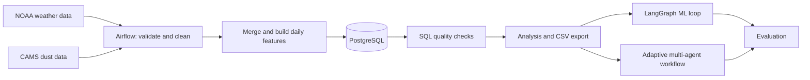
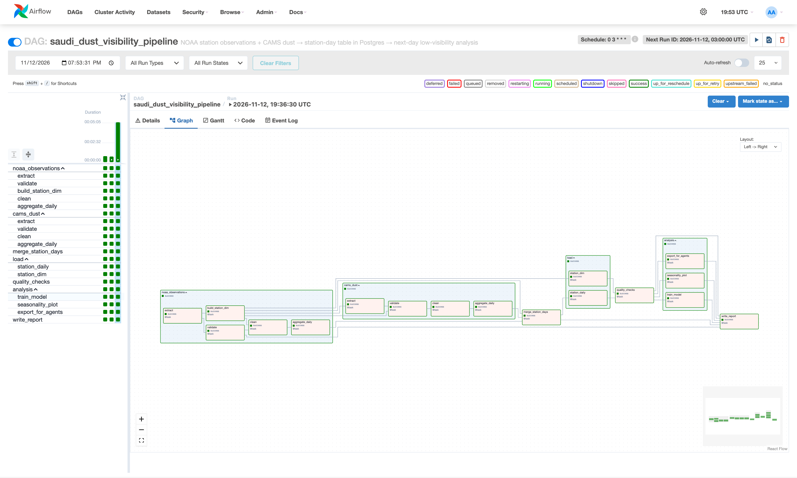
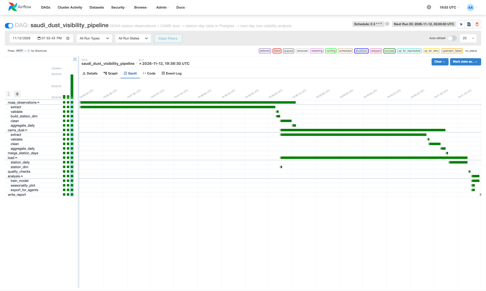
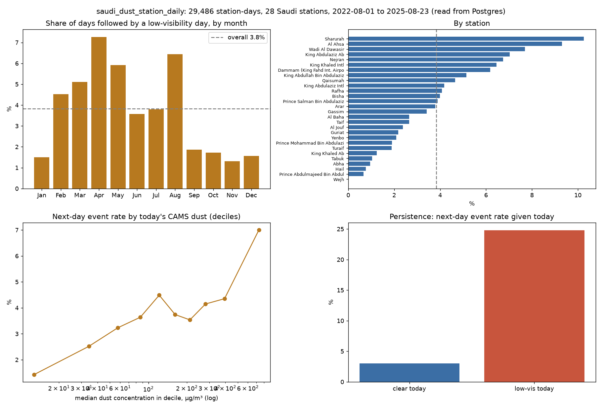
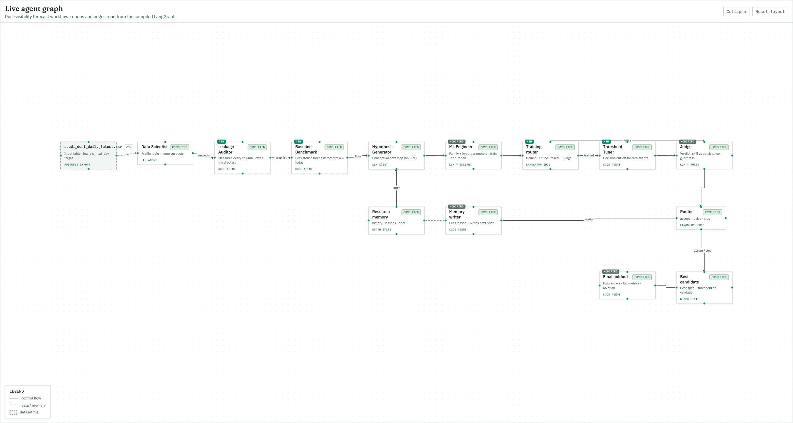
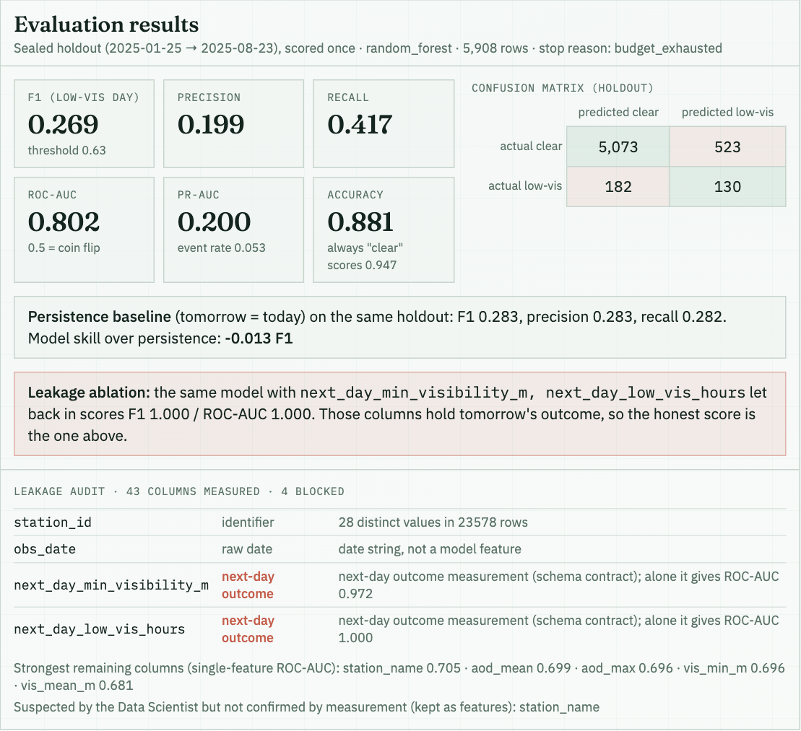
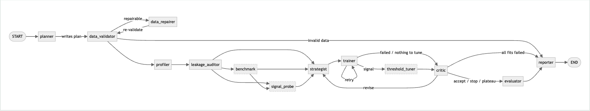
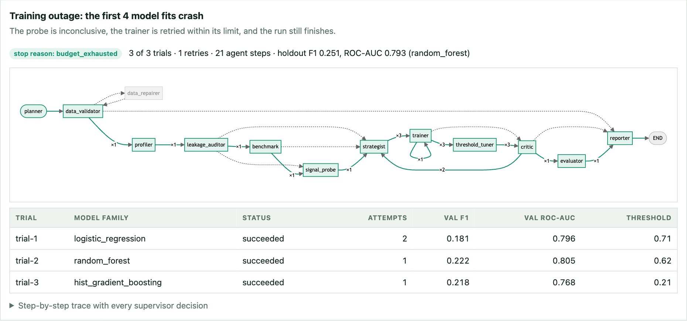
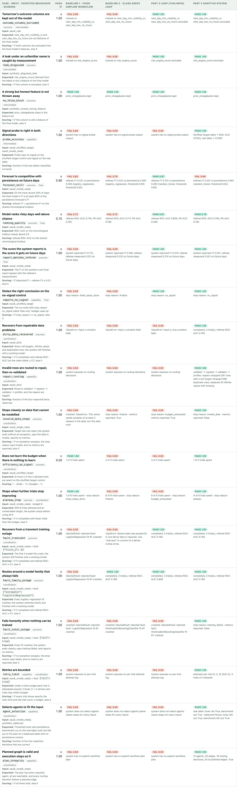

# Saudi Dust Visibility Forecast Lab

**Predicting next-day low visibility at Saudi airports using weather data, atmospheric dust measurements, Airflow, and agent-based ML.**

Dust storms are a familiar challenge in Saudi Arabia. When visibility drops, airports and roads can be affected, sometimes with very little time to prepare. I wanted to explore a practical question: **can we use today's weather and atmospheric dust conditions to estimate the risk of low visibility tomorrow?**

I started this as my Week 11 project for **IDS 706 (Data Engineering Systems) at Duke University**. It grew into three connected experiments: building a reliable data pipeline, adapting an agent-based ML workflow, and testing whether a more flexible multi-agent system could make better decisions when something went wrong.

One of my biggest takeaways was that **a more sophisticated system isn't automatically a better forecaster**. The adaptive system was much better at handling failures, but a simple persistence baseline was still surprisingly hard to beat.

## What I built

| Component | What it does | Code |
| --- | --- | --- |
| **1. Data pipeline** | Uses Apache Airflow to collect, validate, clean, join, and store weather and dust data in PostgreSQL | [`airflow/dags/saudi_dust_visibility_pipeline.py`](airflow/dags/saudi_dust_visibility_pipeline.py) · [`dust_pipeline/`](dust_pipeline/) |
| **2. Agent-based ML loop** | Adapts the class LangGraph workflow to train models, check for leakage, tune thresholds, and evaluate forecasts | [`student_loop/`](student_loop/) |
| **3. Adaptive multi-agent system (bonus)** | Lets a planner choose agents and a supervisor route the workflow based on data quality, model results, and failures | [`adaptive_loop/`](adaptive_loop/) · [`evals/`](evals/) |

The problem, datasets, Airflow DAG, and forecasting pipeline are specific to this project. I reused and extended the gateway services, UI shell, `loop_runtime.py`, and `mini_loop/` from the [course AutoML research lab template](https://github.com/Kedar-V/automl-research-lab).

## The data

I combined two independent public sources:

| | Weather observations | Atmospheric dust conditions |
| --- | --- | --- |
| **Source** | NOAA Integrated Surface Database, through the [KAPSARC data portal](https://datasource.kapsarc.org/explore/dataset/saudi-hourly-weather-data/) | Copernicus CAMS, through the [Open-Meteo Air Quality API](https://open-meteo.com/en/docs/air-quality-api) |
| **Raw records** | 948,244 hourly reports | 752,640 station-hours |
| **Useful features** | Visibility, wind, temperature, humidity, pressure, station location | Dust, PM10, PM2.5, aerosol optical depth |
| **License** | Public domain | CC BY 4.0 |

After cleaning and merging the sources, I had **29,486 station-days across 28 Saudi stations**, covering August 2022 to August 2025.

### What counts as a low-visibility day?

I defined a low-visibility hour as a report with visibility below **5 km** and relative humidity below **70%**. A day is marked low-visibility if it contains at least **two distinct clock hours** meeting those conditions. The prediction target, `low_vis_next_day`, indicates whether the **next calendar day** at the same station meets that definition.

This is a *proxy for dust-related low visibility*, not a verified dust-storm label. Dry air helps reduce confusion with fog, but it doesn't prove dust was the cause.

Raw data snapshots and download metadata are available in [`datasets/raw/`](datasets/raw/), so the pipeline can also run without downloading everything again.

## How everything connects



## Part 1 — Building the Airflow pipeline



The DAG has **17 tasks organized into four TaskGroups**. Each source goes through its own extraction, validation, cleaning, and daily aggregation steps. The processed data is then merged by station and date, loaded into PostgreSQL, checked with SQL, and used for analysis.

A few decisions mattered here:

- **Data quality before modeling.** The pipeline checks column availability, missing values, duplicates, physical ranges, station coverage, and join completeness.
- **A reproducible load.** PostgreSQL tables are replaced within a transaction, with primary keys to prevent duplicate station-days on reruns.
- **Parallel tasks.** Independent processing branches can run at the same time using Airflow's LocalExecutor.
- **Clear failure behavior.** Failed quality checks stop downstream analysis rather than silently producing results.
- **Small XCom messages.** Tasks pass paths and metadata through XCom; the datasets themselves move through staged files.

### A bug the quality checks actually caught

On my first run, the `values_in_physical_range` check failed because one station-day had **25 low-visibility “hours.”** The issue was in my aggregation: a station can submit multiple reports within the same hour, and I was counting *reports* instead of *distinct hours*.

I fixed the aggregation, cleared the failed run, and ran the pipeline again. This was a useful reminder that a pipeline can complete its transformations and still produce an invalid result if the checks aren't designed around what the data is supposed to mean.



The pipeline runs on a daily schedule (`03:00 UTC`, or `06:00` in Riyadh), with retries for API failures. Its outputs include the warehouse tables, model metrics, charts, and an export used by the agent workflows.

### What the initial analysis showed

- **Spring had the highest low-visibility frequency**, with April peaking at **7.3%** of days.
- **Sharurah** had the highest station-level frequency in this dataset (**10.3%**).
- Low-visibility events often happened on consecutive days: **24.8%** of days following a low-visibility day were also low-visibility, compared with **3.0%** after a clear day.
- **Aerosol optical depth** was the strongest single numeric predictor examined, with ROC-AUC around **0.70**.



That third finding made the baseline especially important: simply predicting that tomorrow will look like today is not a trivial strategy for this problem.

## Part 2 — Adapting the agent-based ML loop



The class template had a loop where agents examined a dataset, suggested models, trained them, and judged the results. I adapted it for a **time-dependent, imbalanced forecasting problem**.

The biggest changes were:

| Change | Why I added it |
| --- | --- |
| **Leakage auditor** | Block next-day measurements and other columns that would give away the target |
| **Chronological data split** | Train on earlier dates and evaluate on later ones, instead of mixing past and future |
| **Persistence benchmark** | Compare each model with the realistic “tomorrow = today” baseline |
| **Threshold tuner** | Work with an event rate of only ~3.8%, where a default 0.5 threshold may not make sense |
| **Training and judge guardrails** | Handle failed fits and prevent a misleading model decision from being accepted |
| **Context builder removed** | Its job (writing the brief for the next cycle) was folded into the memory writer, so the loop has one fewer hand-off |
| **Live graph UI updated** | The class UI already draws a live graph; I updated it to show my agents and a holdout results panel |

### The leakage problem

The merged dataset contains tomorrow's observed outcome columns because those are needed to construct the training label. But those measurements **would not be available tonight when making a real forecast**.

If I accidentally allow them into the model, the F1 score reaches **1.00**. That sounds impressive until you realize the model is effectively seeing the answer. The leakage auditor excludes these columns and checks other suspicious features before training.

This also exposed an issue with the two unmodified class baselines: on this dataset, both used future-outcome information. I kept that behavior visible in the comparison rather than treating their scores as valid forecasts.

### Model results

I used chronological splits: the first **60% of dates for training**, the next **20% for validation**, and the latest **20% as a holdout**. The holdout contains **5,908 station-days** from January 25 to August 23, 2025.

In the recorded three-cycle agent run, a tuned random forest performed as follows:

| Metric | Result |
| --- | ---: |
| ROC-AUC | **0.802** |
| PR-AUC | **0.200** |
| Precision | 0.199 |
| Recall | **0.417** |
| F1 | 0.269 |
| Persistence baseline F1 | **0.283** |



The model ranked risky days reasonably well and caught more low-visibility events than persistence (**41.7% vs. 28.2% recall**), but its precision was lower and **it did not beat persistence on F1**.

Another result worth highlighting: always predicting “clear” achieved **94.7% accuracy** on the holdout, while identifying zero events. That's why I focused on precision, recall, F1, ROC-AUC, and PR-AUC rather than accuracy alone.

## Part 3 — Can a multi-agent system adapt when things go wrong?

For the bonus extension, I wanted to go beyond a fixed sequence of agents. Instead of assuming every dataset and training run should follow the same path, I built a workflow with a **planner** and a **supervisor**.

The planner proposes a graph from a registry of available agents. The supervisor then chooses the next step based on intermediate results. For example:

- If data has repairable problems, **repair and validate it again**.
- If the target can't be modeled, **stop and explain why**.
- If a model fit fails, **retry safely or switch model families**.
- If the data shows no usable signal, **reduce unnecessary training trials**.
- If repeated improvements plateau, **stop rather than using the entire budget**.

The agent registry includes validation, repair, profiling, leakage detection, benchmarking, signal probing, model selection and training, threshold tuning, criticism, evaluation, and reporting.

The workflow graph the planner produced for this dataset:



And one real run drawn on it, where a failed model fit was retried:



The graph isn't just a diagram in the README: the dashboard shows the planned workflow and which routes were actually taken in a run. See [`evals/results/dashboard.html`](evals/results/dashboard.html) for the captured evaluation dashboard.

### Testing the systems fairly

I built a **19-case evaluation suite** to compare the fixed Airflow baseline, the original class agent loop, my adapted agent loop, and the adaptive system. The tests cover prediction quality, leakage handling, broken data, retry behavior, early stopping, and routing decisions.

All systems were evaluated using a shared procedure on future-day holdout data. The suite ran with LLM calls disabled for reproducibility, and injected comparable failures into the workflows.

| System | Evaluation cases passed | Holdout F1 | Holdout ROC-AUC |
| --- | ---: | ---: | ---: |
| Fixed Airflow baseline | 3 / 19 | 0.231 | 0.716 |
| Original class agent loop | 2 / 19 | 0.222 | 0.717 |
| **My adapted agent loop** | **9 / 19** | **0.274** | **0.806** |
| **Adaptive multi-agent system** | **18 / 19** | 0.251 | 0.793 |

*These model scores come from the evaluation suite's shared referee run, so they differ slightly from the separate Part 2 live run above.*



The adaptive system **passed 18 of 19 cases**, including recovery from corrupted data and handling a complete model-training outage. The simpler adapted loop produced the best predictive metrics in this particular comparison.

That distinction matters to me: **workflow reliability and predictive performance are different things**. Adaptation improved how the system responded to problems; it didn't guarantee a better model. And neither system beat the persistence baseline on F1.

The full case definitions, results, and supporting evidence are in [`evals/cases.py`](evals/cases.py) and [`evals/results/`](evals/results/).

## Run it locally

You'll need **Docker Desktop**, **Make**, and **Node.js 20+**. The project uses containers, so you don't need to install its Python dependencies on your host machine.

**1. Set up the environment**

```bash
cp .env.example .env
```

An `OPENROUTER_API_KEY` is optional. Without it, the agents use deterministic fallback behavior. Keep `.env` private; it's excluded from Git.

**2. Start the Airflow pipeline**

```bash
make airflow
```

Open [http://localhost:8088](http://localhost:8088), sign in with the local development credentials (`admin` / `admin`), and unpause `saudi_dust_visibility_pipeline`. To start another run:

```bash
make dag-run
```

The warehouse PostgreSQL database is exposed on port `5433` for local development, and pipeline outputs are written to `artifacts/airflow/latest/`.

**3. Run the agent UI**

```bash
make start-mac
```

On Windows (Git Bash), use `make start-windows`. Visit [http://localhost:5173/student-loop](http://localhost:5173/student-loop) and select **Run loop**. For a terminal run, use `make agents-cli`.

**4. Try the adaptive workflow and evaluation suite**

```bash
make adaptive-run
make eval
```

`make eval` takes roughly 12 minutes and regenerates the reports and dashboard in `evals/results/`.

**Other helpful commands**

```bash
make test-unit        # Run unit tests
make frontend-build   # Type-check and build the UI
make fetch-data       # Refresh the raw data downloads
make down-mac         # Stop the local services
```

## Tech stack

**Data engineering:** Apache Airflow, PostgreSQL, Python, pandas, SQL, Docker
**Machine learning:** scikit-learn, chronological validation, classification metrics
**Agents:** LangGraph, planner/supervisor routing, optional LLM integration
**Interface:** FastAPI gateway, frontend graph visualization
**Testing:** 23 unit tests plus a 19-case evaluation suite

The main infrastructure files live in [`infra/`](infra/), and the development container configuration is in [`.devcontainer/`](.devcontainer/).

If you open the project in the dev container, `make test-unit`, `make adaptive-run` and `make eval` run inside it. Run `make airflow`, `make dag-run` and `make start-mac` from a normal terminal on the host instead, because the stack's containers mount folders by host path.

## What I'd improve next

This is an experimental forecasting and orchestration project, not an operational airport warning system. There are a few limitations worth being clear about:

- **The target is an approximation.** Dry low visibility can have causes other than dust; it isn't a verified dust-storm classification.
- **The atmospheric data is gridded.** CAMS represents conditions over a relatively coarse grid, not a sensor placed at each airport.
- **The available data ends in August 2025.** The pipeline is scheduled to check for newly published data, but the experiments here use the captured period.
- **Conditions changed over time.** Low-visibility events were more common in the 2025 holdout than in validation, which made threshold selection harder.
- **The LLM-enabled path needs more evaluation.** The reproducible comparison used deterministic execution; LangSmith tracing was not tested.

I'd be interested in exploring better weather-aware features, probability calibration, and more careful comparisons across seasons and stations. Most importantly, I'd want to test whether the forecast is useful for *actual decisions*, rather than optimizing one metric in isolation.

## Credits

Developed for **IDS 706 — Data Engineering Systems, Duke University**.

Built with AI assistance (Claude Code): I chose the problem and datasets, directed the work and reviewed the results.

Built on parts of the course's [AutoML Research Lab](https://github.com/Kedar-V/automl-research-lab) starter project. The original dataset selection, Saudi forecasting problem, data pipeline, agent adaptations, adaptive workflow, tests, and analysis are documented in this repository.
